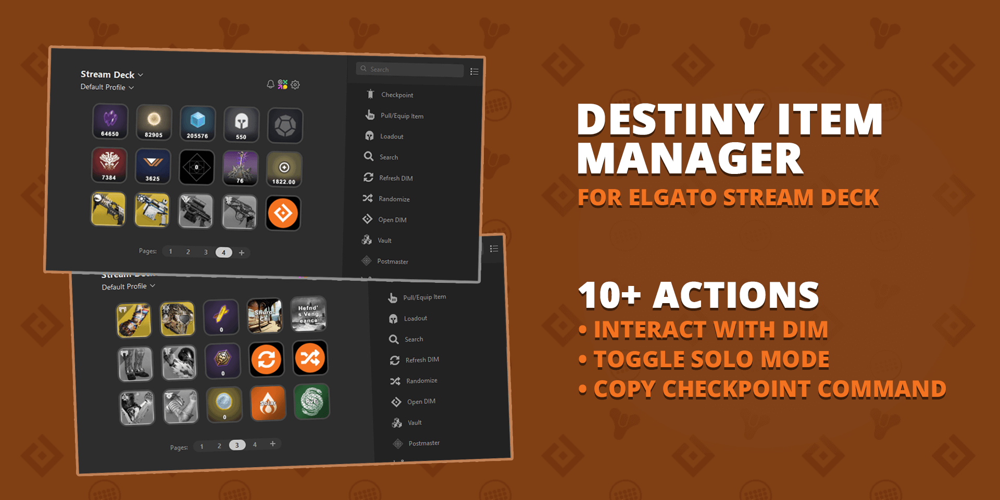
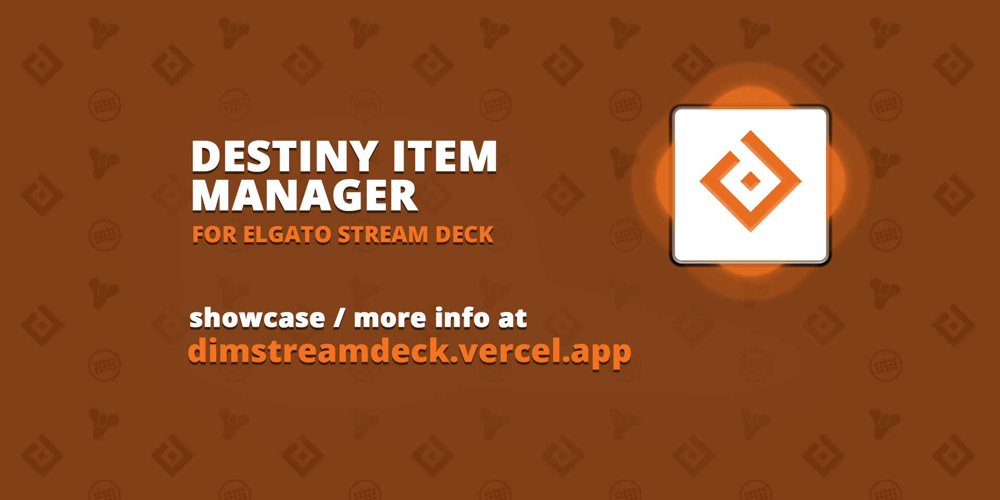

# DIM Stream Deck

A Stream Deck plugin to interact with Destiny Item Manager

## Installation

Download the stream-deck plugin from
the [releases](https://github.com/dim-stream-deck/com.dim.streamdeck/releases/latest)
or from below:

## Features

Go to [dimstreamdeck.vercel.app](https://dimstreamdeck.vercel.app) to see the available actions.

The item picker supports Stream Deck Neo's eight keys. Items appear on the top row;
the bottom row contains exit, up to two configurable filters, and pagination.

## Connecting to DIM

If an action cannot reach DIM, the plugin opens the DIM website with a connection
setup dialog. Choose **Connect Stream Deck** and approve the browser prompts to
open Stream Deck and allow local network access. Then press the action again.
Repeated presses open the setup page at most once every 30 seconds.

With the corresponding DIM website update, the connection indicator checks
saved authorization on page load: amber means checking, green means confirmed,
and red means disconnected or approval is required. The plugin confirms updated
authorization automatically, so no button press is needed to finish setup.

The guided dialog requires the corresponding DIM website update. You can also
connect from DIM's Stream Deck settings or its Stream Deck icon.

## Preview

## Contributing

See [contributing.md](https://github.com/DIM-Stream-Deck/com.dim.streamdeck/blob/main/CONTRIBUTING.md) for information on how to Contribute to the development of DIM Stream Deck.

## Author

Francesco Saverio Cannizzaro ([fcannizzaro](https://github.com/fcannizzaro))

## Loadout browser

Add **Loadout Browser** to a key to browse DIM and in-game loadouts without binding
individual builds to keys. It uses the existing picker profiles on Stream Deck,
Mini, XL, Neo, and Stream Deck+.

The browser starts with the current character. **Filters** lets you choose a class,
all characters, or a hashtag from loadout names and notes. **Next** cycles pages;
**Exit** returns to your previous profile. Tap a loadout to equip it on its listed
character. Class-independent DIM loadouts appear for each compatible character.
Starting class and hashtag filters can be set in the property inspector.

The list refreshes whenever the browser opens. Reopen it after editing loadouts in
DIM. Both DIM and the plugin need the browser update; equipping retains DIM's
normal Bungie API restrictions.
